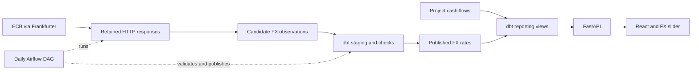

# Bidding & FX

A small data engineering portfolio project with a practical frontend: add a
project, enter its incoming and outgoing cash flows, and see how PHP/USD rates
affect its estimated profit. Use the slider to try other rates without changing
saved amounts.

**React · FastAPI · PostgreSQL · dbt · Airflow**

## What it does

- Saves your own projects and planned cash flows in PHP or USD.
- Shows incoming total, outgoing total, and estimated profit in PHP.
- Simulates FX changes with a slider and an exact numeric input.
- Charts estimated profit/loss over historical FX observations, with the slider
  scenario shown as a dashed comparison line.
- Fetches real ECB reference data through Frankfurter, retaining the original responses.
- Validates and transforms data with dbt before publishing rates.
- Runs one daily Airflow DAG and supports explicit historical FX backfills.

It intentionally stops there. There is no payment ledger, original-bid comparison,
historical project reconstruction, forecasting, or accounting system.

The chart revalues **today's saved cash flows** using the last 90 days of published
FX observations. It is not a record of past project profit. It refreshes every
minute while visible; the source feed updates daily. Hover for date/rate/profit
details or open View observations for the data table. Profits display in cents;
the API retains four decimal places. More history can be
loaded with the same pipeline command using an earlier start date.

## Run locally

Install Docker Desktop with Linux containers and PowerShell 7. Keep Docker running.
Allow about 4 GB of Docker memory for Airflow. The first build needs internet access.

From this folder:

```powershell
.\Start.ps1
```

The script generates ignored local credentials, builds images, initializes the
database and dbt views, and starts the app. Existing data is preserved on reruns.

| Service | Address |
| --- | --- |
| Application | [localhost:15180](http://localhost:15180) |
| API documentation | [localhost:18080/docs](http://localhost:18080/docs) |
| Airflow | [localhost:18081](http://localhost:18081) |

Airflow username is `admin`; its generated password is `AIRFLOW_PASSWORD` in your
local `.env`. Do not commit that file. Ports can be changed there before startup.
The PostgreSQL database has no exposed host port.

Load example projects, optionally:

```powershell
docker compose exec airflow /opt/pipeline-env/bin/python -m pipeline.demo
```

These are labeled synthetic budgets. Reruns preserve edited samples. This command
does **not** insert fake reference FX observations.

Fetch a real observation now, using an explicit completed interval:

```powershell
docker compose exec airflow /opt/pipeline-env/bin/python -m pipeline.run --start 2026-10-30 --end 2026-11-01
```

Use recent dates when demonstrating current data. Open a project and press Refresh
after a pipeline run. Without a reference rate, projects can still be saved and
the hypothetical simulation works. PHP-only estimates need no FX observation.

Stop while keeping projects and rates:

```powershell
.\Stop.ps1
```

Start again with `Start.ps1 -SkipBuild` if source files have not changed. Run
`Start.ps1` normally after code changes. Keep the existing `.env`: replacing it
does not rotate passwords in existing PostgreSQL storage. Do not use
`docker compose down --volumes` unless you intend to erase saved data.

## Follow the data



The daily DAG runs at **08:00 Asia/Manila** for the preceding calendar day, with
two retries. The historical command above uses exactly the same pipeline. It
accepts up to 367 inclusive days per invocation.

Raw responses keep the request URL, timestamp, checksum, and body. Candidate
rates are checked before a transaction publishes them. Identical reruns do not
duplicate logical rates; source corrections retain raw provenance. Failed runs
keep the last successful published rates. Runs are serialized with a database
lock. A weekend uses the real preceding observation date, not a fabricated rate.

Reporting views read current saved cash flows, so editing a project does not wait
for another DAG run. Monetary API values are decimal strings; calculations use
PostgreSQL NUMERIC or Python Decimal. Unknown amounts make an estimate incomplete.

[Read the short code walkthrough](docs/walkthrough.md) for the files to follow
and hand-calculated examples.

## Repository map

| Folder | Responsibility |
| --- | --- |
| `api/` | Validation, transactional project writes, API and scenarios |
| `web/` | Project editor, results, and rate slider |
| `pipeline/` | Source fetching, checked publication, one DAG, sample loader |
| `dbt/` | Candidate staging, quality checks, current reporting views |
| `db/` | Small idempotent PostgreSQL schema |
| `docker/` | Images and local service configuration |
| `tests/` | Financial, API, reporting, source, and pipeline tests |

## Test

After initial startup, run the Python and real dbt tests in Docker:

```powershell
.\Test.ps1
```

For frontend/component tests, a production build, and the complete browser journey,
install Node.js 24 LTS and run:

```powershell
.\Test.ps1 -Browser
```

Tests reset only the explicitly named `bidding_simple_test` database. Browser tests
use a separate API/frontend and labeled offline FX fixtures. They never replace
the application's published rates. Avoid running multiple test invocations together.

See the [verification record](docs/verification.md) for observed results and the
additional automated coverage left for later.

For frontend-only development:

```powershell
cd web
npm ci
npm run dev
```

Vite proxies the API to localhost:18080. Python changes are copied into the Docker
image, so rebuild through Start.ps1 to use them in the running application.

## Limits and sources

This is a **local portfolio demo**, with unauthenticated project access and a local
Airflow standalone deployment. It is not ready for public multiuser hosting.
The figures describe planned cash flows, not realized payments or accounting profit.
Reference rates are not bank execution rates. The UI shows the actual observation
date; it does not promise a live or holiday-adjusted feed.

The provider is fixed to [Frankfurter's ECB route](https://frankfurter.dev/), using
[ECB reference-rate data](https://www.ecb.europa.eu/stats/policy_and_exchange_rates/euro_reference_exchange_rates/html/index.en.html).
Airflow uses its documented [standalone quick start](https://airflow.apache.org/docs/apache-airflow/stable/start.html).
No source-rate fallback or FX forecasting is included.
